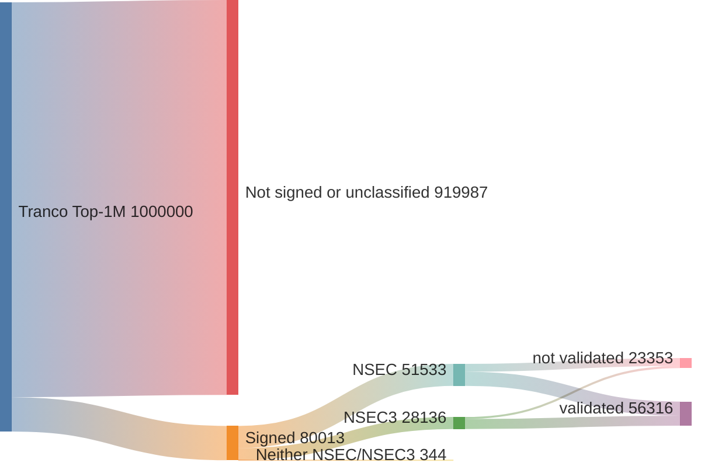
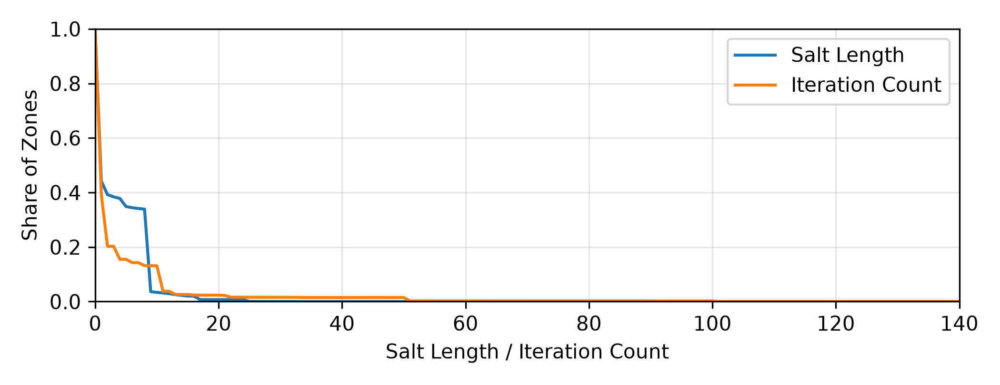

# Artifact Submission for "Same Attack, Different Failures: Architecture Shapes NSEC3 Mitigation Effectiveness"

This contains benchmark measurements of DNS resolvers under NSEC3 attack, additional resolver profiling data, and a measurement of NSEC3 deployment across the Tranco Top-1M domains.

## Contents

| Folder | Contents |
|---|---|
| [`benchmark-data/`](benchmark-data/) | Resolver measurements under NSEC3 attack, a pre-compiled viewer, and pre-rendered figures |
| [`tranco-measurement/`](tranco-measurement/) | DNSSEC and NSEC3 deployment measurement of the Tranco Top-1M domains |
| [`resolver-profiling/`](resolver-profiling/) | Additional profiling measurements of the resolvers |

## Downloading the measurement data

The large measurement datasets are not part of the Git repository and are distributed through the [GitHub Releases page](https://github.com/orgruza/nsec3-tdsc-artifact/releases).
The following folders are missing from a fresh clone:

| Missing folder | Release archive | Size (extracted) |
|---|---|---:|
| `benchmark-data/measurements/` | `benchmark-data.tar.gz` | 9.6 GB |
| `resolver-profiling/profiled-data/measurements/` | `resolver-profiling.tar.gz` | 277 MB |
| `tranco-measurement/data/` | `tranco-measurement.tar.gz` | 17 GB |

The extracted data requires about 27 GB of free disk space.
Download the archives and extract them so that their contents are placed at the listed locations.
The viewer binaries, the pre-rendered figures, and the Tranco results in `tranco-measurement/results/` are included in the repository and work without the download.

## Benchmark data and viewer

The `benchmark-data/` folder contains the resolver evaluation data and a terminal viewer to explore it interactively.

<video src="benchmark-data/demo.mp4" controls width="100%"></video>

[Viewer demo](benchmark-data/demo.mp4)

The data contains measurements of BIND 9.16.1, 9.18.24, and 9.20.13, Knot Resolver 5.6.0, 5.7.3, and 6.1.0, PowerDNS Recursor 4.8.2, 5.0.5, and 5.2.4, and Unbound 1.17.1 and 1.24.0 under attack at different attack rates.

Pre-rendered figures for every resolver are in the `figures/` subfolder.

### TL;DR Viewer Instructions

Start the viewer from within the folder, using either the Ubuntu 24.04 build or the musl-libc build that does not require any specific glibc:

```
$ cd benchmark-data
$ ./viewer          # or ./viewer-musl
```

Press `Return` to enter the command line and open a measurement from `measurements/` with the `show` command:

```
show 1min-8x12.5rps-50iter-benign-2026-06-20T21:33:37
```

The command `help` lists all available commands, and `Esc` exits the viewer.


See [benchmark-data/README.md](benchmark-data/README.md) for the full viewer instructions and the figures.

## Tranco NSEC3 measurement

The `tranco-measurement/` folder contains DNSSEC deployment and denial-of-existence measurements for 1,000,000 domains from the Tranco Top-1M list.
The domains were queried through a local DNSSEC-validating Unbound resolver on October 24-26, 2026.

Of the 1,000,000 domains, 80,013 (8.00%) are classified as signed.
The diagram shows which denial-of-existence mechanism the signed domains use, and how many of these proofs were validated by the resolver.



The distribution of the observed NSEC3 parameters:



### TL;DR Script instructions

The classification can be reproduced from the included measurement data without issuing new DNS queries:

```
$ cd tranco-measurement
$ python3 -u src/classify.py --input data/processed/tranco_1m_deduplicated.jsonl --output data/processed/tranco_1m_classification_reproduced.csv
```

See [tranco-measurement/README.md](tranco-measurement/README.md) for the methodology and full results, and [DATA_DICTIONARY.md](tranco-measurement/DATA_DICTIONARY.md) for the field definitions.

## Resolver profiling

The `resolver-profiling/profiled-data/measurements/` folder contains additional profiling measurements of the resolvers.
Each experiment directory is named by its duration, attack request rate, NSEC3 iteration count, benign request rate, and timestamp.
Each resolver directory within contains the files `cpu-high.log`, `cpu-low.log`, `net.log`, `benign.log`, `nsec3-attacker.log`, and `test.json`.
See [resolver-profiling/README.md](resolver-profiling/README.md) for details.

## Requirements

- The viewer is precompiled for x86-64 Linux and requires a terminal supported by [Ratatui](https://ratatui.rs/).
- The scripts require Python 3 with `matplotlib`, `numpy`, and `colorspacious`.
